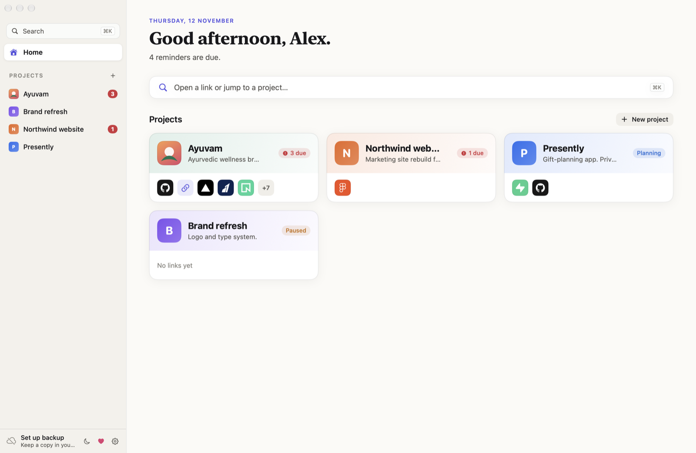
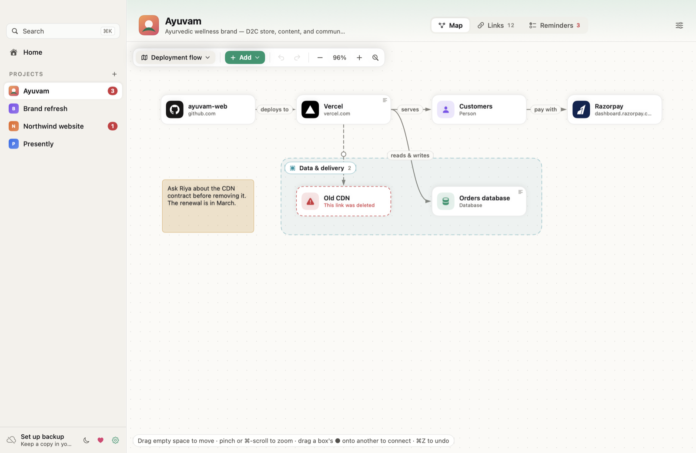
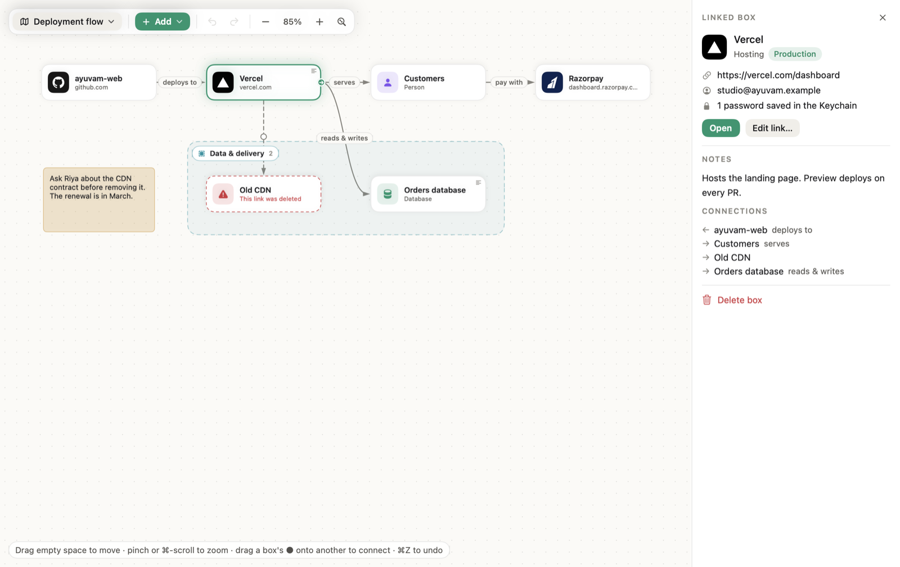
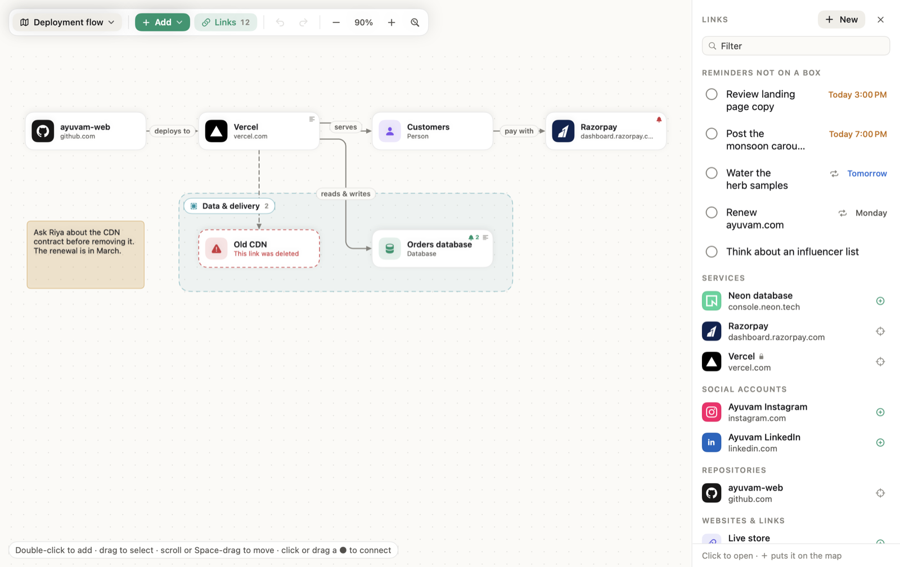
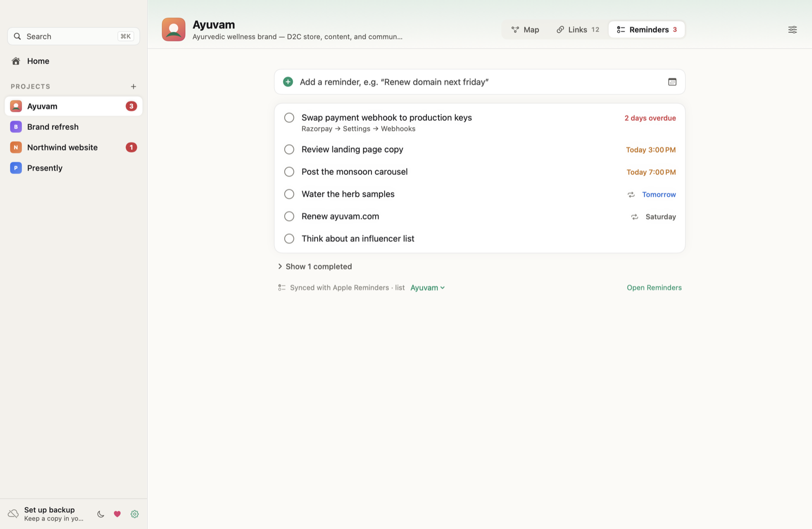
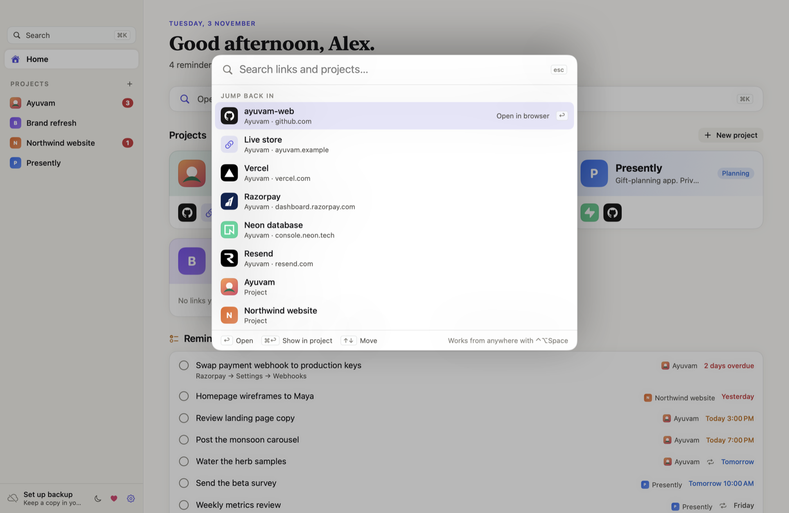
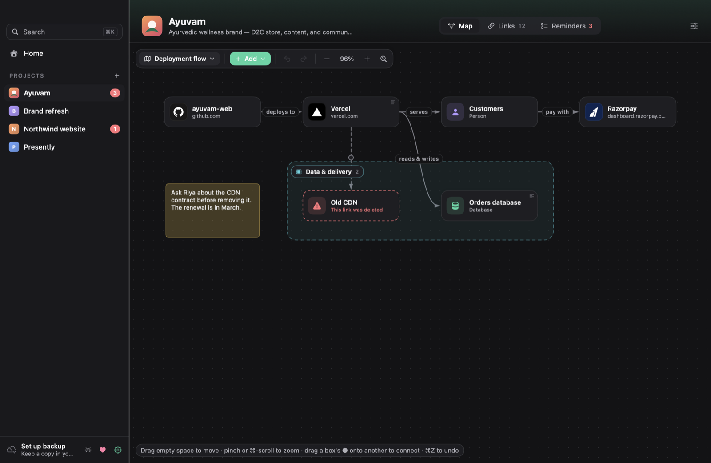

<div align="center">

# Context

**Every project at a glance: a map, its links, and what's next.**

A free, minimal Mac app. Map how each project fits together, keep its dashboards and accounts one click away, and keep its reminders in Apple Reminders.
No account, no server, no subscription. Your data stays on your Mac.

[](../../releases/latest)
[](LICENSE)
[](Sources/Context)
[](https://ko-fi.com/hiteshgupta)

[Website](https://hiteshldt.github.io/context/) · [Download](../../releases/latest) · [Build from source](#build-from-source) · [♥ Support](https://ko-fi.com/hiteshgupta)



</div>

## Why

You come back to a side project, a client job, or your own product after 20 days and spend the first hour rebuilding it from memory. Which Vercel account was it? Where does the database live? What was I about to do next?

Context keeps the answer on one page per project, with two tabs:

| Tab | What it's for |
| --- | --- |
| **Map** | A diagram of the people, apps, and services behind the project and how they connect, with every dashboard, repo, social account, doc, and AI chat beside it under **Links** (real logos for 100+ brands, one click opens them). Click any box for its notes and details. |
| **Reminders** | What's next, kept in the project's own list in Apple Reminders, so it reaches your iPhone too. |

## Features

- **A map you'll actually use.** Pinch to zoom, drag empty space to move around, and the map opens fitted to the screen. Group boxes into labelled frames, keep notes on any box, and undo anything with ⌘Z.
- **⌘K to open anything.** Type "neon", "vrcl", or "gc" for Google Cloud and press Return. It also works from any app with ⌃⌥Space and from the menu bar.
- **Reminders that sync.** Type "Renew domain next friday" or "Call Riya tomorrow 5pm" and the date is picked up as you type. Each project gets its own list in Apple Reminders, so reminders notify you on your Mac, iPhone, and Watch.
- **Project pictures.** Give each project its logo or a photo: click the project's icon, or drop an image on it.
- **Light and dark.** Follow the Mac, or pick one with the ☀︎/☾ button in the sidebar.
- **Passwords in the Keychain**, never in Context's data. Revealing one needs Touch ID, and a copied password clears from the clipboard after 45 seconds.
- **Optional app lock** with Touch ID or your Mac password, and auto-lock when you step away.
- **Backup to iCloud Drive, Google Drive, Dropbox, or OneDrive** through their Mac apps. Context writes a dated copy after each change and keeps 30 days.

<table>
<tr><td></td><td></td></tr>
<tr><td></td><td></td></tr>
<tr><td></td><td></td></tr>
</table>

## Install

1. Download `Context.zip` from the [latest release](../../releases/latest) and unzip it.
2. Move **Context.app** to your Applications folder.
3. The first time, **right-click the app → Open → Open**. Context is free and not notarized by Apple, so macOS asks once.

Requires macOS 14 Sonoma or later. The download is built for Apple silicon; on an Intel Mac, build from source below.

### Build from source

You need Apple's Swift command-line tools (`xcode-select --install`).

```sh
git clone https://github.com/Hiteshldt/context.git
cd context
zsh scripts/build-app.sh --install   # builds, copies to /Applications, and opens it
```

## Map

- **Move around:** drag empty space, scroll with two fingers, pinch (or ⌘-scroll) to zoom, and press ⌘0 to fit the whole map.
- **Start a map:** every project has one. On an empty map, "Build from my links" lays out the links you've saved.
- **Add anything with a double-click:** name a box, or paste a link ("github.com/acme/web", "vercel.com") and it's saved with its logo and placed where you clicked. You can also pick one of the project's links.
- **Links:** the Links button opens every link in the project beside the map. Click one to open it, ＋ to put it on the map, or ⌖ to find its box. Removing a box from the map keeps the link saved.
- **Boxes:** Person, App, API, Database, Storage, Cloud, Email, Payment, Step, and sticky notes. A box linked to a saved link shows its logo and follows its renames; if the link is deleted, the box is flagged.
- **Details on one click:** the panel on the right shows a box's notes, URL, account, environment, and connections. Boxes with notes show a small ≡ marker.
- **Groups:** Add → Group draws a labelled frame. Drag boxes in, drag the name tag to move the group with everything inside, and drag the corner to resize.
- **Connect:** drag any of a box's ● handles onto another box. Click a line anywhere along it to label it, dash it, reverse it, or delete it. Lines can be elbow, curved, or straight (map menu, or a connection's details), and go around boxes that are in the way.
- **Select several:** Shift-click or Shift-drag a rectangle, or ⌘A. Drag one to move them all; line them up, space them evenly, or group them from the panel. Dragged boxes snap into line with the others.
- **Keys:** Delete removes the selection, arrows nudge it (⇧ for bigger steps), Return renames, ⌘A selects all, ⌘D duplicates, Esc deselects (or closes Links), ⌘Z / ⇧⌘Z undo and redo.

## Reminders

The first time you open a project's Reminders tab, click **Connect Apple Reminders** and allow access. Your first reminder in a project creates a list with the project's name in Apple Reminders (or uses an existing list with that name; you can pick another list at the bottom of the tab). Context doesn't keep its own copy: Apple Reminders is the only place your reminders live, so they sync through iCloud as usual.

## Keyboard shortcuts

| Shortcut | Action |
| --- | --- |
| ⌘K | Search and jump to anything |
| ⌃⌥Space | Same, from any app |
| ⌘1 · ⌘2 | Map · Reminders |
| ⇧⌘H | Home |
| ⌘N | New link in the current project |
| ⇧⌘N | New project |
| ⇧⌘B | Back up now |
| ⇧⌘E | Export a backup file |
| ⌃⌘L | Lock Context (when the app lock is on) |

## Privacy and your data

Context has no telemetry, no analytics, and no sync service of its own. Its only network use:
- opening the links you click, and
- fetching website icons once for links without a built-in logo. You can turn this off in ⚙.

```text
~/Library/Application Support/Context/workspace.json           your data
~/Library/Application Support/Context/workspace.previous.json  the previous save
~/Library/Application Support/Context/backup-settings.json     where backups go
```

These files are readable only by your Mac account but are not encrypted, so keep passwords in a link's Keychain credentials rather than in notes. The optional app lock keeps Context's windows, launcher, and menu bar panel closed until you unlock; it does not encrypt the files on disk.

Backups include projects (with their pictures), maps, and links. Keychain passwords aren't included, and reminders live in Apple Reminders. Restoring always asks first and keeps a copy of your current data.

## Development

```sh
zsh scripts/test.sh        # data, migration, map layout, reminders, pictures, launcher, backup, and brand-icon tests
zsh scripts/build-app.sh   # builds dist/Context.app
zsh scripts/snapshot.sh    # renders every screen with demo data (never your data) to .build/snapshots/
```

To try it with a throwaway data folder: `CONTEXT_DATA_DIR="$PWD/.build/manual" dist/Context.app/Contents/MacOS/Context`.

The code is plain SwiftUI and AppKit in `Sources/Context`. The original product spec is in [PRODUCT_SPEC.md](PRODUCT_SPEC.md). Issues and pull requests are welcome.

## Support

Context is free and always will be. If it saves you time, you can buy me a coffee. ♥

[](https://ko-fi.com/hiteshgupta)

Starring the repo ⭐ or telling a friend helps too.

## License

[MIT](LICENSE). Brand icons come from [Simple Icons](https://simpleicons.org) (CC0). Brand names and logos belong to their owners and are used only to label your saved links.
